# ◆ FinVault — Digital Banking Simulation

A premium, responsive **educational fintech simulation** built entirely with Python 3.10+ standard libraries, SQLite, HTML and CSS. **No AI. No real money.**

> Includes 15 genuine screenshots supplied from a local Windows run. All data and funds are fictional.

## Screenshots

These screenshots were captured during a local demo session.

### Login
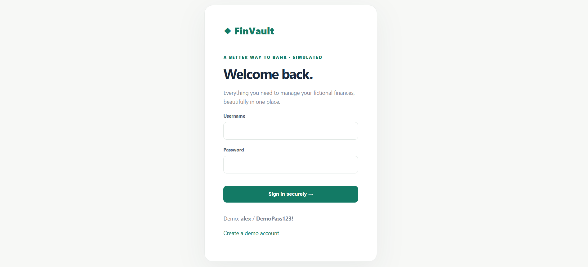

### Customer Dashboard
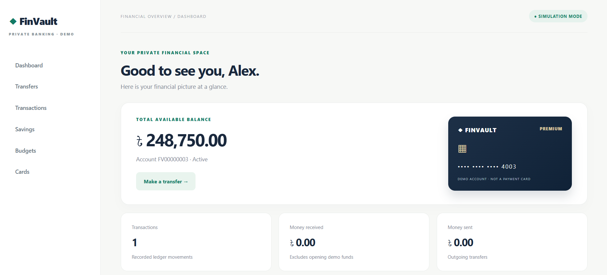

### Customer Dashboard Activity
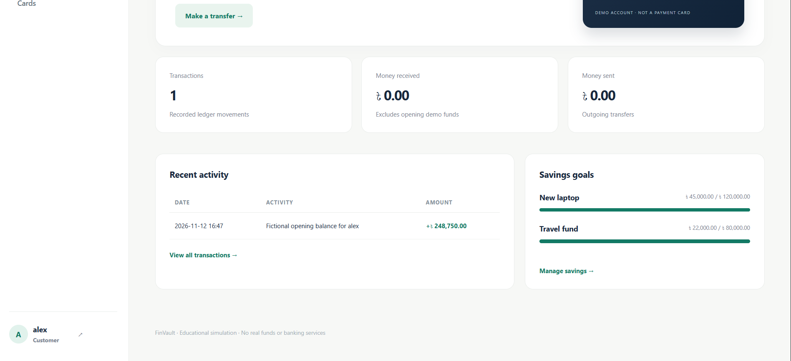

### Transfer Form
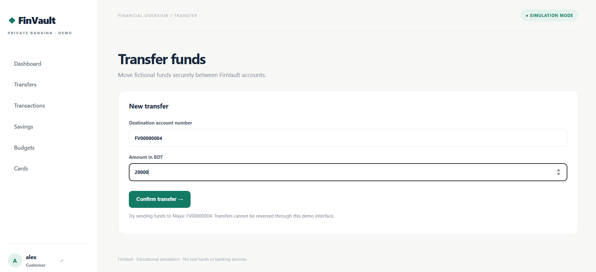

### Transaction History
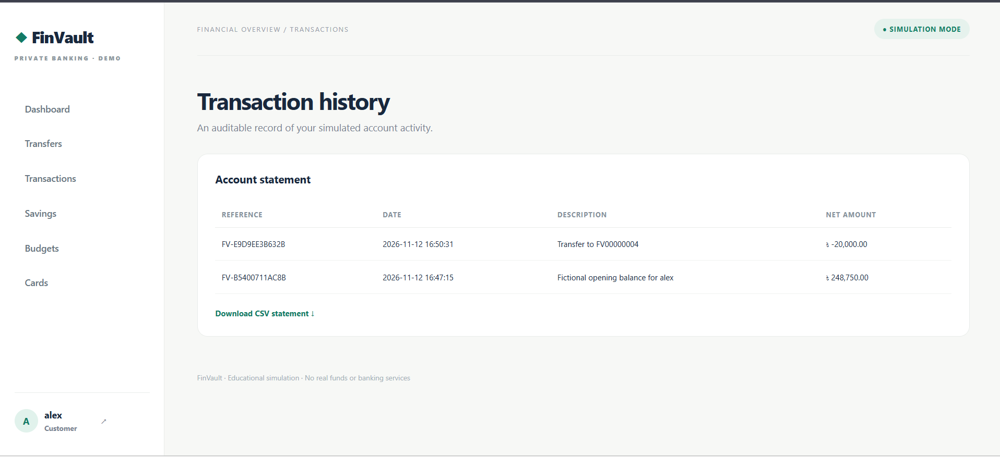

### Savings Goals
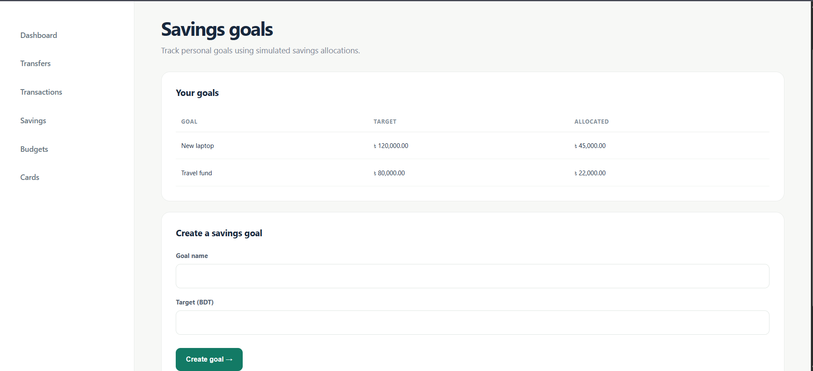

### Budget Planner
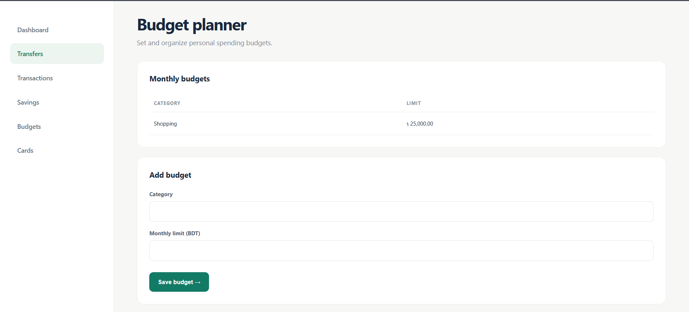

### Customer Virtual Card
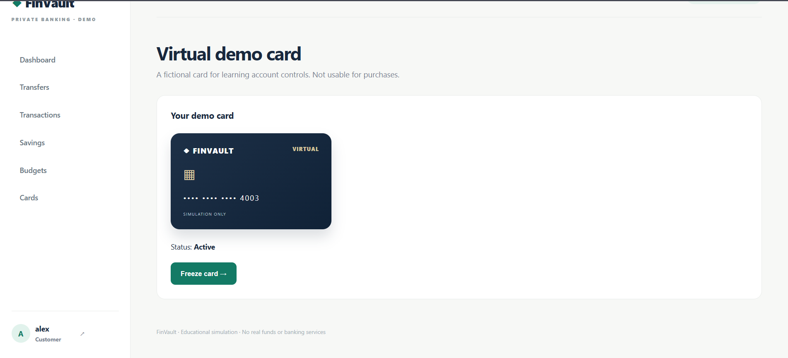

### Admin Login
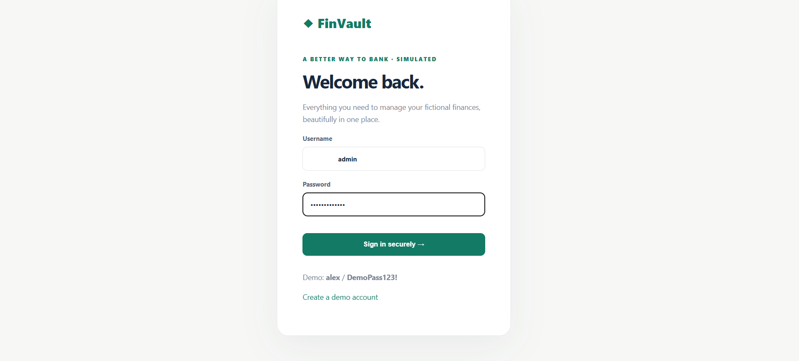

### Admin Dashboard
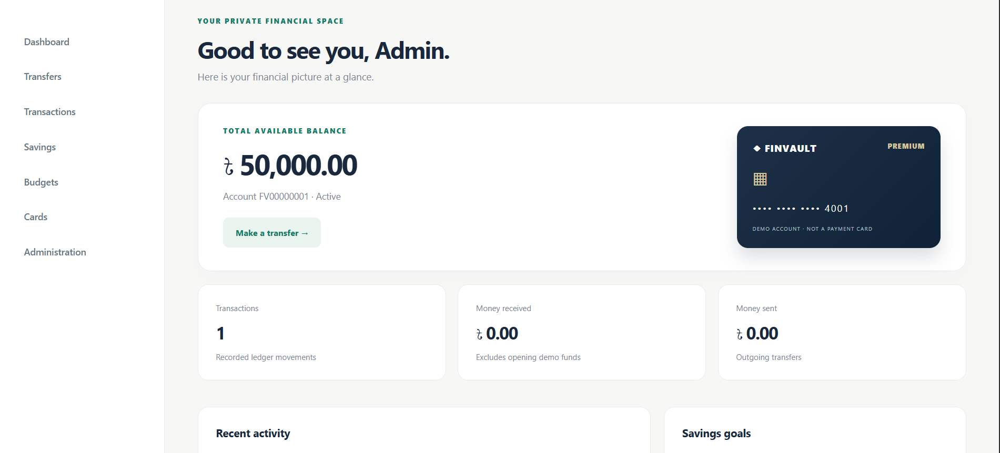

### Admin Frozen Card
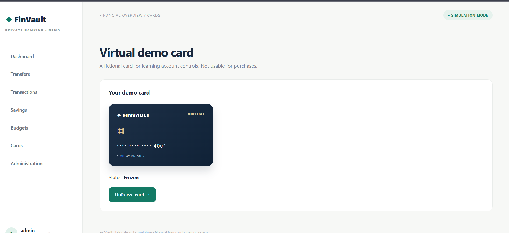

### Admin Accounts
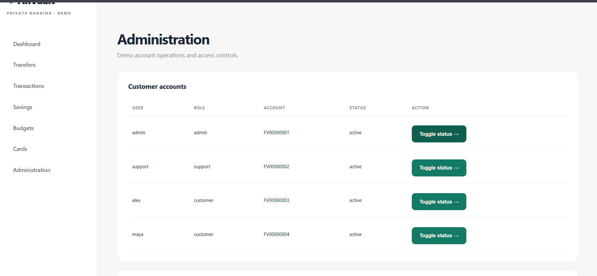

### Admin Audit Log
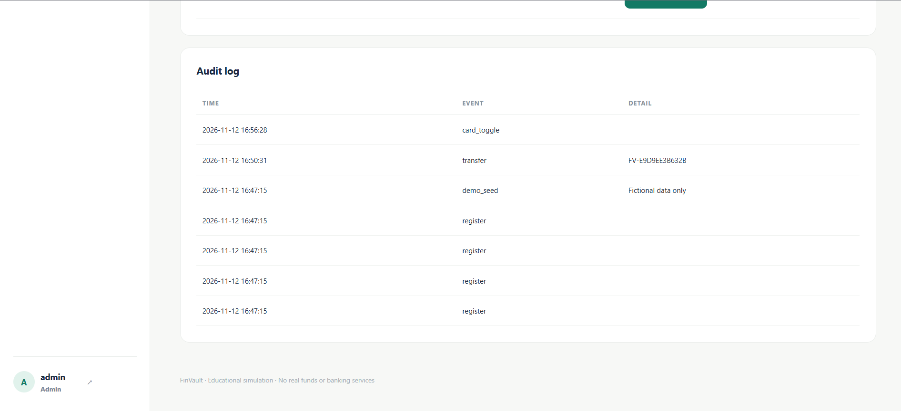

### Support Dashboard
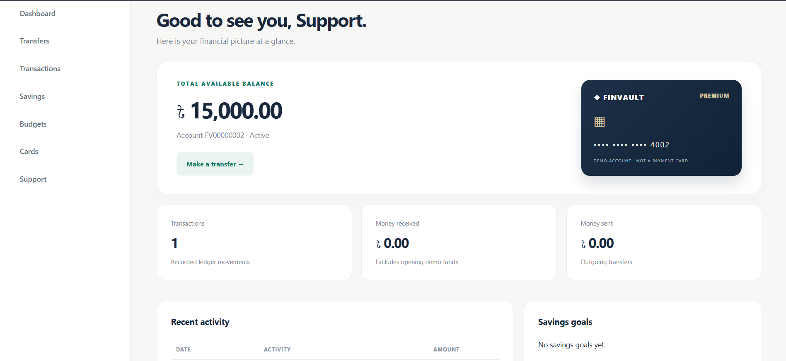

### Support Workspace
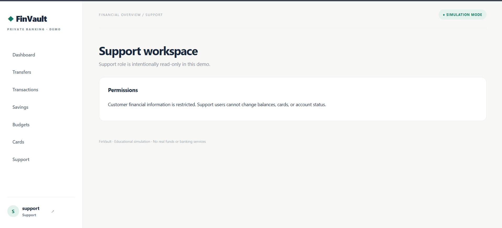

The exported example transaction statement is in [`examples/sample-statement.csv`](examples/sample-statement.csv).

## Screenshots

These screenshots were captured during a local demo session.

### Login

### Customer Dashboard

### Customer Dashboard Activity

### Transfer Form

### Transaction History

### Savings Goals

### Budget Planner

### Customer Virtual Card

### Admin Login

### Admin Dashboard

### Admin Frozen Card

### Admin Accounts

### Admin Audit Log

### Support Dashboard

### Support Workspace

The exported example transaction statement is in [`examples/sample-statement.csv`](examples/sample-statement.csv).

## Screenshots

These screenshots were captured during a local demo session.

### Login

### Customer Dashboard

### Customer Dashboard Activity

### Transfer Form

### Transaction History

### Savings Goals

### Budget Planner

### Customer Virtual Card

### Admin Login

### Admin Dashboard

### Admin Frozen Card

### Admin Accounts

### Admin Audit Log

### Support Dashboard

### Support Workspace

The exported example transaction statement is in [`examples/sample-statement.csv`](examples/sample-statement.csv).

## Quick start (Windows)
1. Install Python 3.10+ (check **Add Python to PATH**).
2. Extract this ZIP.
3. Double-click `setup_windows.bat` to create the fictional database.
4. Double-click `run_finvault.bat` and open http://127.0.0.1:8000.
5. Log in with **alex / DemoPass123!**. Other demo users: **maya**, **support**, **admin**, all with the same demo password. **Never use these credentials in a real service.**

Alternatively: `python app.py --seed` then `python app.py`.

## Implemented features
- Customer registration, salted scrypt password hashing, HTTP-only SameSite cookies, session-based authentication and CSRF tokens.
- Customer dashboard with account balance, transaction summary and savings progress.
- Account-to-account transfers with SQLite `BEGIN IMMEDIATE` atomic transactions, double-entry postings, funds checks, frozen-account checks and idempotency keys.
- Transaction history and downloadable CSV statements.
- Savings goals, spending budgets, demo virtual card freezing/unfreezing.
- Admin account freeze/unfreeze and audit log; restricted read-only support view.
- Responsive premium minimal design and preloaded fictional data.
- Seven automated banking/authentication tests.

## Run tests
`python -m unittest discover -s tests -v` or `run_tests.bat`.

## Architecture
- `app.py`: local HTTP server, routes, templates, auth, SQLite schema and banking engine.
- `static/style.css`: premium responsive design.
- `tests/test_core.py`: banking invariants and authentication tests.
- `docs/`: architecture and security notes.

## Important limitations
This is a **local demonstration**, not a production banking application. It uses an in-memory session store, a single-process application lock, SQLite, and a simple local HTTP server. It has **no real payment integration, no MFA, no rate limiting, no production-grade security review, no banking license, no PCI compliance, and no real debit/credit cards**. Never expose the development server publicly or store real personal/financial information. Use PostgreSQL, HTTPS, a maintained web framework, persistent sessions, hardened authorization, and independent security assessment for any production-oriented rebuild.

Savings goals are **tracking-only** and do not reserve or transfer funds. Budgets are manually set limits. The demo treasury is an internal fictional opening-balance counterparty.

## License
MIT. See LICENSE.
